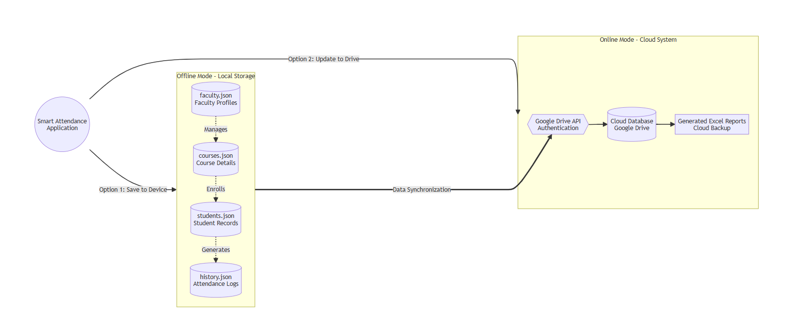

# Unified NFC and AI-Powered Academic Management Framework

[]()
[]()
[](LICENSE)

Official repository for the **Unified NFC and AI-Powered Academic Management Framework**, a comprehensive smart academic system that automates attendance tracking, examination mark distribution, data analytics, and emergency response management[cite: 39]. 

Manual attendance and academic monitoring are traditionally inefficient and error-prone[cite: 39]. This framework utilizes Near-Field Communication (NFC) technology to eliminate proxy attendance and securely log student entry/exit times[cite: 39]. Furthermore, it leverages classic Machine Learning (Predictive AI) to analyze educational indicators, bypassing the computational overhead of Large Language Models (LLMs) to accurately predict student performance trends and automate structured reporting[cite: 39]. A dedicated emergency module also maintains critical health and contact information, ensuring rapid response capabilities on campus[cite: 39].

---

## 🏗️ System Architecture & Technology Stack

The framework is built on a hybrid, offline-first architecture integrating physical data capture hardware with a Python-based desktop interface[cite: 39].

* **Frontend:** Python (`tkinter`, `ttk`) for a lightweight, responsive desktop GUI[cite: 39].
* **Backend & Database:** Python standard library with local JSON storage and Pandas for serverless, offline data manipulation[cite: 39].
* **Cloud Synchronization:** Google Drive API (`pydrive2`) for automated secure backups[cite: 39].
* **AI & Analytics:** Scikit-learn (Linear Regression) for predictive modeling, and Matplotlib (`FigureCanvasTkAgg`) for dynamic chart generation[cite: 39].
* **Hardware:** R20DC 125 kHz & 13.56 MHz 2-in-1 USB RFID/IC Card Reader and ISO/IEC 14443 compliant NFC tags[cite: 39].
* **External APIs:** Twilio API for automated SMS absentee alerts[cite: 39].

> **Dual-Mode Storage Architecture**
> 
> *(The system supports local JSON saving for offline continuity and automated Google Drive synchronization for cloud backups)[cite: 39, 41].*

---

## 🤖 How AI and Automation Evaluate Human Performance

A core innovation of this framework is its reliance on classical Machine Learning and Rule-Based Expert Systems to objectively evaluate student performance, entirely avoiding the unpredictability and resource drain of generative LLMs[cite: 39].

### 1. Rule-Based Attendance & Punctuality Evaluation
The system automates human punctuality evaluation using a deterministic Rule-Based Expert System[cite: 39]. 
* **Lateness Detection:** The system compares the NFC scan time against the scheduled class time. If the entry scan occurs more than 15 minutes late, the student is automatically flagged as "LATE"[cite: 39].
* **Automated Intervention Thresholds:** The framework continuously evaluates cumulative attendance. If attendance drops below 85%, a warning email is dispatched[cite: 39]. If it drops below 80%, a critical alert is sent via SMS and email to parents and department heads, enforcing timely academic intervention[cite: 39].

> **Attendance Timeline & Movement Tracking**
> 
> *(Gantt chart visualization plotting exact entry scans, in-class durations, and early exit scans to assess individual physical engagement)[cite: 39, 41].*

### 2. Predictive AI & Correlation Analytics
To evaluate academic trajectories, the system employs Supervised Machine Learning via `scikit-learn`'s Linear Regression module[cite: 39]. 
* **Mathematical Trend Calculation:** The AI analyzes numerical inputs (attendance percentages) and maps them to outcome variables (final marks)[cite: 39]. It calculates the Pearson correlation coefficient ($r$) to measure the magnitude of this relationship[cite: 39].
* **Performance Prediction:** By calculating the regression trend, the AI determines actionable metrics—for example, empirical results showing that student achievement rises by 0.5 points per 1% increase in attendance[cite: 39]. This allows the system to project estimated final grades based on current engagement[cite: 39].

> **AI Correlation Analysis (Scatter Plot & Regression Line)**
> 
> *(Scatter plot and linear regression line generated by the AI module, visually demonstrating the positive mathematical correlation between attendance rates and final academic performance)[cite: 39, 41].*

### 3. Outcome-Based Education (OBE) Attainment Logic
Human academic evaluation is mapped directly to programmatic goals using an automated OBE algorithm[cite: 39]. Assessment questions are aligned with Course Outcomes (COs), and attainment is calculated via strict thresholds:
* **Attained (Level 3):** Marks $\ge$ 60% of CO max[cite: 39].
* **Partially Attained (Level 1-2):** Marks between 40% and 59% of CO max[cite: 39].
* **Not Attained (Level 0):** Marks $<$ 40% of CO max[cite: 39].

> **CO Attainment Profiling**
> 
> *(Radar/spider chart visualizing the overall section average CO attainment profile, allowing administrators to identify curricular strengths and weaknesses)[cite: 39, 41].*

---

## 📊 Visual Dashboards & Interface Modules

The desktop application is divided into distinct, role-based modules for faculty and administrators[cite: 39].

### Academic Records & Examination Management
Faculty can securely authenticate to enter marks manually or via batch CSV uploads[cite: 39]. The system validates entries against maximum thresholds and prevents duplicate records[cite: 39].

> **Student Records Interface**
> 
> *(Tabular interface displaying structured academic data, including card IDs, course details, and comprehensive assessment scores)[cite: 39, 41].*

### Performance Distribution Analytics
The analytics suite transforms raw examination data into interpretable visualizations to gauge class-wide health[cite: 39].

> **Individual Performance Breakdown**
> 
> *(Bar chart detailing a student's score distribution across midterm/final quizzes, OBE assignments, and total evaluations)[cite: 39, 41].*

> **Class Performance Distribution**
> 
> *(Histogram categorizing students into mark ranges to quickly identify overall class performance trends)[cite: 39, 41].*

### Emergency Information Repository
Beyond academics, the system acts as a life-saving tool by centrally managing student medical needs and contact information[cite: 39]. During registration, blood groups and emergency phone numbers are recorded[cite: 39]. 

> **Emergency Medical Dashboard**
> 
> *(Dashboard showing the overall campus blood group distribution via pie chart, equipped with dynamic dropdown filters to isolate potential donors by specific academic courses during a crisis)[cite: 39, 41].*

---

## 📂 Repository File Structure

```text
├── Attandance/                             # Core Python scripts and attendance logic
├── Blood record.png                        # Emergency repository dashboard[cite: 40]
├── Course Outcome.png                      # CO attainment bar charts[cite: 40]
├── Create account Part 1.png               # Faculty registration UI[cite: 40]
├── Create account Part 2.png               # Faculty setup UI[cite: 40]
├── Data Analytics and AI Part 1.png        # Individual student performance bar chart[cite: 40]
├── Data Analytics and AI Part 2...png      # Class performance distribution histogram[cite: 40]
├── Data Analytics and AI Part 3...png      # At-risk student/section analysis[cite: 40]
├── Data Analytics and AI Part 4...png      # AI Linear Regression scatter plot[cite: 40]
├── Student Records Tab.png                 # Main academic records database UI[cite: 40]
├── app_icon.ico                            # Desktop application icon[cite: 40]
├── grant chart.png                         # Daily attendance Gantt chart[cite: 40]
├── spider chart.png                        # OBE radar chart[cite: 40]
├── storage.png                             # Hybrid cloud/local storage architecture map[cite: 40]
└── system overall.png                      # NFC scanning and logging workflow diagram[cite: 40]
